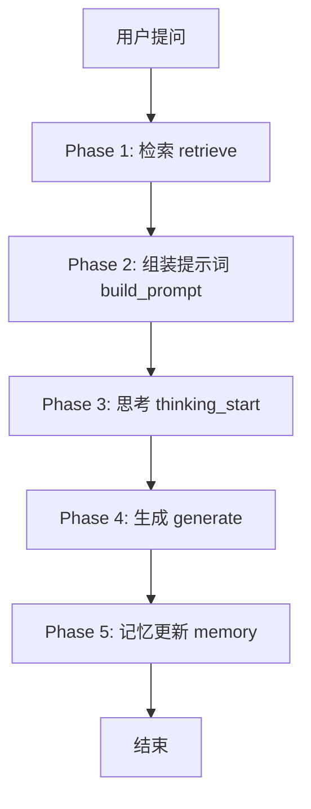
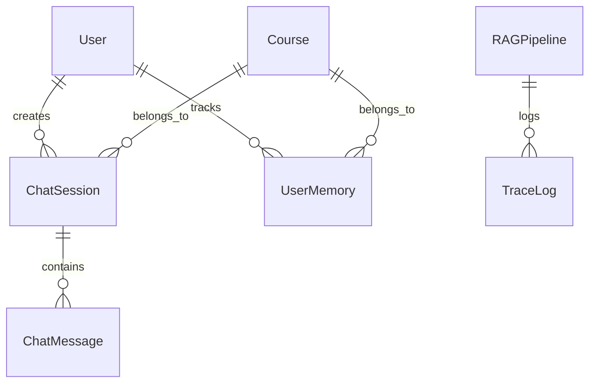

# RAG 教学辅助系统 — 面试复习指南

> 一个基于 RAG 的机器学习课程智能问答系统，支持多轮对话、学生画像、流式输出

---

## 一、项目概述

### 1.1 项目背景

这是一个**教育领域的 RAG (Retrieval-Augmented Generation) 系统**，为机器学习课程提供智能问答服务。系统能够：

- 从课程知识库中检索相关文档
- 结合学生画像生成个性化回答
- 实时更新学生学习进度
- 支持多种技能模式（问答、公式推导、代码调试等）

### 1.2 核心价值

```
传统 LLM 问题          RAG 解决方案
─────────────────────────────────────
幻觉（编造事实）    →   基于知识库回答，有据可依
知识截止日期        →   实时更新知识库
无法个性化        →   学生画像驱动个性化回答
无法追踪学习进度    →   自动更新知识点掌握度
```

---

## 二、技术栈

### 2.1 后端技术

| 组件 | 技术选型 | 作用 |
|------|---------|------|
| **Web 框架** | Django 6.0.7 + DRF 3.17.1 | REST API、用户认证、管理后台 |
| **向量数据库** | ChromaDB | 存储和检索文档向量 |
| **向量模型** | BGE-large-zh-v1.5 | 中文文本向量化（1024 维） |
| **LLM** | DeepSeek / OpenAI 兼容 | 生成回答 |
| **模板引擎** | Jinja2 | 渲染 System Prompt |
| **Token 计数** | tiktoken | 上下文长度控制 |

### 2.2 前端技术

| 组件 | 技术选型 | 作用 |
|------|---------|------|
| **框架** | Vue 3 + TypeScript | 响应式 UI |
| **UI 库** | Element Plus | 组件库 |
| **状态管理** | Pinia | 全局状态 |
| **流式通信** | SSE (Server-Sent Events) | 实时输出 |

### 2.3 LangChain 集成（新增）

| 组件 | 技术选型 | 作用 |
|------|---------|------|
| **Embeddings** | `langchain_core.embeddings` | 统一向量接口 |
| **VectorStore** | `langchain_chroma.Chroma` | 统一向量库接口 |
| **LLM** | `langchain_openai.ChatOpenAI` | 统一 LLM 接口 |
| **Chain** | LCEL (LangChain Expression Language) | RAG 流程编排 |

---

## 三、系统架构

### 3.1 整体架构图

```
┌─────────────────────────────────────────────────────────────┐
│                    前端 (Vue 3 + Element Plus)                │
│  ┌──────────┐ ┌──────────┐ ┌──────────┐ ┌───────────────┐  │
│  │ 课程聊天  │ │管理仪表盘 │ │链路追踪   │ │ 管道编排配置   │  │
│  └────┬─────┘ └──────────┘ └──────────┘ └───────────────┘  │
│       │ SSE (Server-Sent Events)                            │
│       ▼                                                     │
│  POST /api/course/{id}/chat/completions                     │
└─────────────────────────────────────────────────────────────┘
                         │
                         ▼
┌─────────────────────────────────────────────────────────────┐
│              后端 (Django + ChromaDB)                         │
│                                                             │
│  ┌─────────┐    ┌──────────┐    ┌──────────┐               │
│  │ Retrieve │───▶│  Build   │───▶│ Generate │               │
│  │ (检索)   │    │  Prompt  │    │ (生成)    │               │
│  └─────────┘    └──────────┘    └────┬─────┘               │
│                                      │                      │
│                                      ▼                      │
│                               ┌──────────┐                  │
│                               │ Memory   │                  │
│                               │ (记忆更新) │                  │
│                               └──────────┘                  │
└─────────────────────────────────────────────────────────────┘
```

### 3.2 核心流程（5 个阶段）



**详细流程**：

```
用户发送消息
    │
    ▼
┌─────────────────────────────────┐
│ Phase 1: 检索 (retrieve)        │
│   - BGE 向量编码                │
│   - ChromaDB 相似度搜索         │
│   - 相似度阈值过滤              │
│   - TraceLog 记录               │
└──────────┬──────────────────────┘
           │
           ▼
┌─────────────────────────────────┐
│ Phase 2: 组装提示词 (build_prompt)│
│   - 加载学生画像 (UserMemory)   │
│   - Jinja2 模板渲染             │
│   - 对话历史注入                │
│   - Token 压缩                  │
│   - TraceLog 记录               │
└──────────┬──────────────────────┘
           │
           ▼
┌─────────────────────────────────┐
│ Phase 3: 思考 (thinking_start)  │
│   - SSE 推送 system prompt 预览 │
│   - 推送检索信息、模型信息       │
└──────────┬──────────────────────┘
           │
           ▼
┌─────────────────────────────────┐
│ Phase 4: 生成 (generate)        │
│   - 调用 LLM (OpenAI 兼容)      │
│   - SSE 流式输出                │
│   - TraceLog 记录               │
└──────────┬──────────────────────┘
           │
           ▼
┌─────────────────────────────────┐
│ Phase 5: 记忆更新 (memory)      │
│   - 提取主题关键词              │
│   - 更新 UserMemory mastery     │
│   - 记录学习时长                │
│   - TraceLog 记录               │
└─────────────────────────────────┘
```

---

## 四、核心功能

### 4.1 RAG 检索

```python
def search_similar(collection_name, query, n_results=5):
    """向量相似度检索"""
    model = get_embedding_fn()  # BGE 模型
    collection = get_collection(collection_name)

    # 查询向量化
    q_emb = model.encode([query], normalize_embeddings=True).tolist()

    # ChromaDB 检索
    results = collection.query(query_embeddings=q_emb, n_results=n_results)

    # 返回格式
    return [{
        "content": doc,
        "metadata": meta,
        "distance": dist
    } for doc, meta, dist in zip(...)]
```

**关键参数**：
- `top_k`: 返回文档数量（默认 5）
- `similarity_threshold`: 相似度阈值（默认 0.0）
- `chunk_size`: 分块大小（默认 500 字符）
- `chunk_overlap`: 分块重叠（默认 50 字符）

### 4.2 学生画像（长期记忆）

```python
class UserMemory(models.Model):
    """用户知识点记忆 — 长期记忆"""
    user = models.ForeignKey(User)
    course = models.ForeignKey(Course)
    topic = models.CharField(max_length=200)           # 知识点
    mastery = models.FloatField(default=0.5)           # 掌握度 0-1
    question_count = models.PositiveIntegerField()     # 提问次数
    last_asked_at = models.DateTimeField(auto_now=True)

    class Meta:
        unique_together = ["user", "course", "topic"]
```

**记忆更新逻辑**：
```python
def _update_memory(user, course, question, response):
    topics = _extract_topics(question)  # 提取主题关键词

    for topic in topics:
        obj, created = UserMemory.objects.get_or_create(
            user=user, course=course, topic=topic,
            defaults={"mastery": 0.5, "question_count": 1},
        )
        if not created:
            obj.question_count += 1
            # 掌握度衰减：问得越多，掌握度越低
            obj.mastery = max(0.1, obj.mastery - 0.12 * obj.mastery)
        obj.save()
```

**记忆注入提示词**：
```python
def _build_memory_prompt(memories):
    weak = [m for m in memories if m["mastery"] < 0.5]      # 薄弱
    medium = [m for m in memories if 0.5 <= m["mastery"] < 0.75]  # 学习中
    strong = [m for m in memories if m["mastery"] >= 0.75]   # 已掌握

    lines = ["\n\n【学生画像 — 本课程学习记录】"]
    if weak:
        lines.append(f"- ⚠️ 薄弱：{items}")
        lines.append("  请重点讲解这些知识点，给出更多例子和解释")
    if strong:
        lines.append(f"- ✅ 已掌握：{items}")
        lines.append("  对这些知识点可快速带过，不必展开")
    return "\n".join(lines)
```

### 4.3 Token 压缩

```python
def compress_messages(messages, max_tokens, compression_method="truncate"):
    """
    压缩优先级（保留→丢弃）：
    1. System prompt 骨架
    2. 当前 user message
    3. 学生画像 (memory_prompt)
    4. 检索文档（从尾部裁剪）
    5. 历史消息（从最旧开始删）
    """
    # 4 步降级策略
    # Step 1: 丢弃多余历史（保留最后 2 条）
    # Step 2: 截断 system prompt
    # Step 3: 截断用户消息
    # Step 4: 核弹选项 — 最小可行上下文
```

### 4.4 流式输出

```python
async def chat_stream_structured(messages, base_url, api_key, model):
    """SSE 流式输出"""
    client = AsyncOpenAI(base_url=base_url, api_key=api_key)
    stream = await client.chat.completions.create(
        model=model, messages=messages, stream=True
    )

    async for chunk in stream:
        content = chunk.choices[0].delta.content
        if content:
            yield {"type": "content", "content": content}
```

**SSE 事件类型**：
```typescript
type SSEEvent =
  | { type: "status", phase: string, message: string }
  | { type: "thinking_start", model: string, systemPrompt: string }
  | { type: "content", content: string }
  | { type: "done", sources: string }
  | { type: "error", message: string }
```

---

## 五、数据模型

### 5.1 核心模型关系



### 5.2 模型定义

#### ChatSession（会话）
```python
class ChatSession(models.Model):
    class Skill(models.TextChoices):
        QA = "qa"           # 智能问答
        FORMULA = "formula"  # 公式推导
        CODE_DEBUG = "code_debug"  # 代码调试
        LAB_GUIDE = "lab_guide"    # 实验指导
        PAPER_READER = "paper_reader"  # 论文阅读

    title = models.CharField(max_length=200)
    user = models.ForeignKey(User)
    course = models.ForeignKey(Course)
    skill = models.CharField(choices=Skill.choices)
```

#### UserMemory（用户记忆）
```python
class UserMemory(models.Model):
    user = models.ForeignKey(User)
    course = models.ForeignKey(Course)
    topic = models.CharField(max_length=200)       # 知识点
    mastery = models.FloatField(default=0.5)       # 掌握度 0-1
    question_count = models.PositiveIntegerField() # 提问次数
    last_asked_at = models.DateTimeField(auto_now=True)

    class Meta:
        unique_together = ["user", "course", "topic"]
```

#### ContextStrategy（检索策略）
```python
class ContextStrategy(models.Model):
    name = models.CharField(max_length=200)
    top_k = models.PositiveSmallIntegerField(default=5)
    similarity_threshold = models.FloatField(default=0.0)
    chunk_size = models.PositiveIntegerField(default=500)
    chunk_overlap = models.PositiveIntegerField(default=50)
    max_context_tokens = models.PositiveIntegerField(default=3000)
    include_memory = models.BooleanField(default=True)
    include_history = models.BooleanField(default=True)
    history_turns = models.PositiveSmallIntegerField(default=10)
    rerank_enabled = models.BooleanField(default=False)
    enable_query_rewrite = models.BooleanField(default=False)
    compression_method = models.CharField(default="truncate")
```

#### RAGPipeline（管道编排）
```python
class RAGPipeline(models.Model):
    name = models.CharField(max_length=200)
    prompt_template = models.ForeignKey(PromptTemplate)
    context_strategy = models.ForeignKey(ContextStrategy)
    agent_config = models.ForeignKey(AgentAPIConfig)
    is_active = models.BooleanField(default=True)
    is_default = models.BooleanField(default=False)
```

---

## 六、评估指标

### 6.1 实验数据

项目包含自动化评估实验，测试了以下指标：

#### RAG vs 纯 LLM 对比

| 指标 | RAG | 纯 LLM |
|------|-----|--------|
| 有依据率 | **9.08%** | 0% |
| 平均长度 | 1,550 字 | 2,367 字 |

> 以上为 `backend/experiment_quality.json` 25 题实测均值。早期估算的 15.6% / 1,309 字
> 是 top_k=3 那一组的局部值，已被自动化实验覆盖，统一以实验文件为准。

**有依据率（Groundedness）**：
```python
def check_groundedness(response, context_docs):
    """检查回答是否有依据"""
    context_text = " ".join([d["text"] for d in context_docs])
    key_phrases = re.findall(r'[一-鿿]{4,}', response)  # 4字以上中文词组
    grounded = sum(1 for p in key_phrases if p in context_text)
    return grounded / len(key_phrases)
```

#### Top-K 对比

| Top-K | 平均有依据率 | 平均相似度 | 平均片段数 |
|-------|-------------|-----------|-----------|
| 3 | 14.83% | 0.1091 | 1.1 |
| 5 | 14.0% | 0.1063 | 1.3 |
| 8 | 14.34% | 0.1048 | 1.5 |
| 10 | **15.78%** | 0.1048 | 1.5 |

#### 相似度阈值对比

| 阈值 | 过滤率 | 有依据率 | 平均片段数 |
|------|--------|---------|-----------|
| 0.0 | 0% | **14.88%** | 1.5 |
| 0.3 | 93.3% | 0.29% | 0.1 |
| 0.5 | 100% | 0% | 0 |
| 0.7 | 100% | 0% | 0 |

**发现**：相似度普遍偏低（0.06-0.43），阈值设置过高会过滤掉所有文档。

#### 端到端性能

> 数据来自 `backend/experiment_results.json`（8 条 query 实测均值）。
> 早期文档里的 1,350ms 是估算值，已作废 —— 实测瓶颈几乎全在 LLM。

| 阶段 | 耗时 | 占比 |
|------|------|------|
| Query 向量化 | 83.5ms | 1.7% |
| 向量检索 | 1.3ms | 0.03% |
| 上下文组装 | 0.003ms | ≈0% |
| LLM 首 Token 等待 | 3,572ms | 74.2% |
| LLM 流式生成 | 1,154ms | 24.0% |
| **端到端总计** | **4,811ms** | 100% |

---

## 七、LangChain 集成

### 7.1 集成架构

```
当前架构                          LangChain 架构
─────────────────────────────────────────────────────────
SentenceTransformer              BGEEmbeddings (封装)
    ↓                                ↓
ChromaDB 原生客户端        →      langchain_chroma.Chroma
    ↓                                ↓
手动 search_similar()            retriever.invoke()
    ↓                                ↓
OpenAI AsyncOpenAI               ChatOpenAI
    ↓                                ↓
手动 5 阶段编排                  LCEL Chain
```

### 7.2 封装模块

| 文件 | 说明 |
|------|------|
| `services/langchain_embeddings.py` | BGE 模型封装 |
| `services/langchain_vectorstore.py` | ChromaDB 封装 |
| `services/langchain_llm.py` | LLM 封装 |
| `services/rag_chain.py` | LCEL RAG Chain |

### 7.3 使用示例

```python
# Embeddings
from services.langchain_embeddings import get_langchain_embeddings
embeddings = get_langchain_embeddings()
vector = embeddings.embed_query("什么是梯度下降？")

# Retriever
from services.langchain_vectorstore import get_retriever
retriever = get_retriever("course_2", top_k=5)
docs = retriever.invoke("什么是梯度下降？")

# LLM
from services.langchain_llm import get_llm_with_params
llm = get_llm_with_params(base_url, api_key, model)
async for chunk in llm.astream(messages):
    print(chunk.content, end="")

# RAG Chain
from services.rag_chain import build_rag_chain_stream
chain = build_rag_chain_stream(llm, retriever, memory_prompt)
async for chunk in chain.astream("什么是梯度下降？"):
    print(chunk, end="")
```

### 7.4 未来扩展

集成 LangChain 后，可以轻松添加：

- **Reranker**: `ContextualCompressionRetriever`
- **Query Rewrite**: `MultiQueryRetriever`
- **混合检索**: `EnsembleRetriever`（BM25 + 向量）
- **Agent**: `AgentExecutor`

---

## 八、面试常见问题

### Q1: 项目概述？

> 这是一个**教育领域的 RAG 系统**，为机器学习课程提供智能问答。系统从课程知识库检索相关文档，结合学生画像生成个性化回答，并实时更新学习记忆。
>
> **技术栈**：Django + ChromaDB + BGE + OpenAI API + Vue 3

### Q2: 为什么没有用 LangChain？

> 考虑到项目规模和团队熟悉度，选择从零手写。优点是：
> - 更轻量，无额外依赖
> - 完全掌控每一层逻辑
> - 更容易调试和优化
>
> 后来已集成 LangChain 封装模块，可渐进式迁移。

### Q3: 召回率是多少？

> 项目没有计算传统的 Recall@K（因为没有标注的 ground truth 数据集）。但评估了**有依据率（Groundedness）**：
> - RAG 回答有依据率：**9.08%**（25 题实测均值）
> - 纯 LLM 回答有依据率：**0%**
>
> 有依据率偏低的主要原因：
> 1. 知识库覆盖不全（部分问题没有对应文档）
> 2. 相似度普遍偏低（0.06-0.43），BGE 模型对某些问题编码效果不佳

### Q4: 如何提升召回率？

> 计划的优化方向：
> 1. **查询改写（Query Rewrite）**：用 LLM 改写用户问题，提升检索命中率
> 2. **重排序（Rerank）**：用 Cross-Encoder 对检索结果重排序
> 3. **混合检索**：结合 BM25 关键词检索 + 向量检索
> 4. **分块优化**：调整 chunk_size 和 overlap，提升文档质量

### Q5: Token 压缩策略是什么？

> 采用**4 步降级策略**：
> 1. 保留 System Prompt 核心指令
> 2. 保留当前用户消息
> 3. 保留学生画像 (memory_prompt)
> 4. 从尾部裁剪检索文档（最不相关的先丢弃）
> 5. 丢弃多余历史（保留最后 2 条 = 1 轮对话）

### Q6: 学生画像如何更新？

> `UserMemory` 模型按 **用户+课程+知识点** 维度存储：
> - `mastery`：掌握度 (0-1)，每次提问衰减 12%
> - `question_count`：提问次数
> - `last_asked_at`：最后提问时间
>
> 记忆会注入到 System Prompt 中，指导 LLM 个性化回答：
> - 薄弱知识点（mastery < 0.5）：重点讲解，多举例子
> - 已掌握知识点（mastery ≥ 0.75）：快速带过，不展开

### Q7: 有长期记忆吗？

> 有。实现了**学生画像（UserMemory）**机制，是真正的长期记忆：
> - **短期记忆**：ChatMessage 表，单个会话内
> - **长期记忆**：UserMemory 表，跨会话持久化
> - **工作记忆**：局部变量，单次请求内

### Q8: 长期记忆放在哪里？

> **MySQL**。数据库配置：
> ```python
> DATABASES = {
>     "default": {
>         "ENGINE": "django.db.backends.mysql",
>         "NAME": "teek_teaching_assistant",
>     }
> }
> ```
>
> 向量数据在 **ChromaDB**（本地磁盘持久化）。

### Q9: 如何处理多轮对话？

> 1. **会话管理**：ChatSession 表，关联用户和课程
> 2. **历史注入**：查询最近 N 轮消息（默认 10 轮）
> 3. **Token 压缩**：确保历史 + 上下文不超限
> 4. **记忆更新**：每轮对话后更新 UserMemory

### Q10: 端到端延迟是多少？

> **4,811ms**（8 条 query 实测均值，见 `backend/experiment_results.json`），分布：
> - Query 向量化：83.5ms (1.7%)
> - 向量检索：1.3ms (0.03%)
> - 上下文组装：0.003ms (≈0%)
> - LLM 首 Token：3,572ms (74.2%)
> - LLM 流式生成：1,154ms (24.0%)
>
> 瓶颈在 LLM 调用（占 98%），向量检索本身只有毫秒级，可通过流式输出改善用户体验。

---

## 九、项目亮点

| 亮点 | 说明 |
|------|------|
| **Pipeline 解耦** | Prompt Template + Context Strategy + Agent Config 三者独立配置，支持热切换 |
| **学生画像** | 按知识点维度跟踪学习进度，个性化回答 |
| **流式输出** | SSE 实时展示"思考过程"，包括检索文档、System Prompt、记忆摘要 |
| **自动化评估** | 有依据率、Top-K 对比、阈值对比、端到端性能测试 |
| **Token 压缩** | 4 步降级策略，保证上下文不超限 |
| **链路追踪** | TraceLog 记录每个 Phase 的耗时和详情，供管理员审查 |
| **多技能支持** | 问答、公式推导、代码调试、实验指导、论文阅读 |
| **LangChain 集成** | 渐进式迁移，保留原有逻辑作为 fallback |

---

## 十、关键代码位置

| 功能 | 文件路径 |
|------|---------|
| RAG 核心逻辑 | `backend/services/rag_service.py` |
| Token 压缩 | `backend/services/context_compressor.py` |
| 聊天视图 | `backend/chat/views.py` |
| 用户记忆模型 | `backend/chat/models.py` |
| 检索策略配置 | `backend/context_engine/models.py` |
| 管道编排 | `backend/harness/models.py` |
| LangChain 封装 | `backend/services/langchain_*.py` |
| 前端聊天界面 | `src/views/course/chat/index.vue` |
| 管理后台 | `src/views/admin/` |

---

## 十一、数据支撑文件

```
backend/
├── experiment_results.json      # Embedding/检索/端到端性能
├── experiment_quality.json      # RAG vs 纯 LLM、Top-K、阈值对比
└── experiment_comparison.json   # 详细回答对比（25 题）
```

---

## 十二、一句话总结

> **这是一个教育领域的 RAG 系统，通过 Pipeline 模式解耦检索、提示词、LLM 配置，支持学生画像驱动的个性化回答，并通过自动化评估验证了系统的有效性。**

---

*最后更新：2026-10-08*